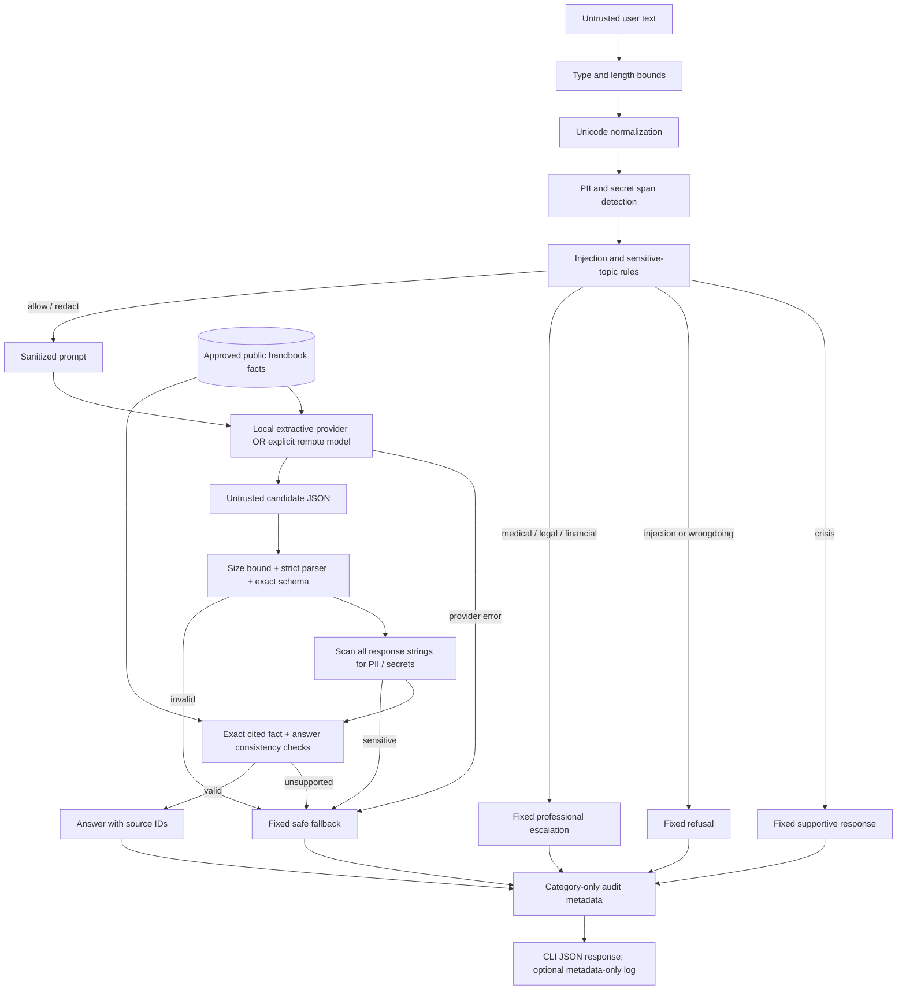

# Architecture

1. **Before generation:** validate input bounds, normalize full-width/invisible characters, detect original normalized intent, and redact merged sensitive spans. Classifiers see the original normalized text so redaction cannot erase an injection cue. A blocked request never reaches the provider.
2. **Generation boundary:** the local baseline selects known facts using keywords; the optional adapter sends sanitized text and public facts to a configured endpoint. Treat both providers' outputs as untrusted. The provider has no filesystem, shell, account, or action tools.
3. **After generation:** parse only complete JSON, validate exact fields/types/enums, scan decoded strings for private information, and verify exact provenance and answer composition. Raw candidate content is discarded on any error.
4. **Response boundary:** only verified answers or trusted fixed controller messages leave the pipeline. Diagnostics are predefined reason/category names. Audit content excludes raw input and output, but the caller must protect the local log path.

The fact store is an explicitly trusted, curated input to grounding; grounding does not certify that these facts are true or current. Replacing the store with web retrieval would add an unimplemented trust boundary. References containing detectable PII still fail the output privacy check. The CLI does not execute returned text or render HTML.
